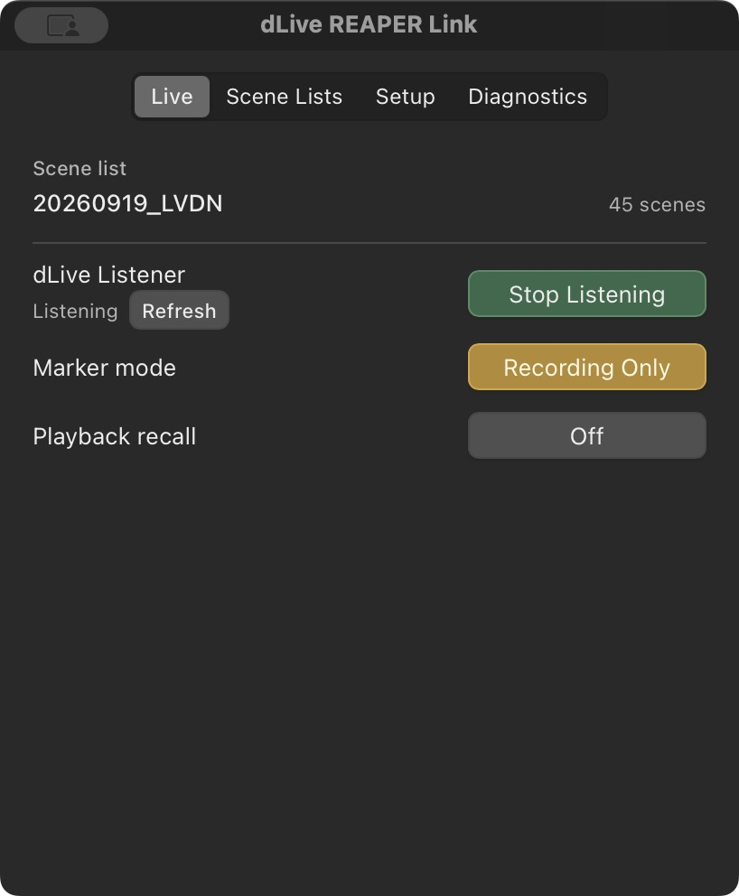
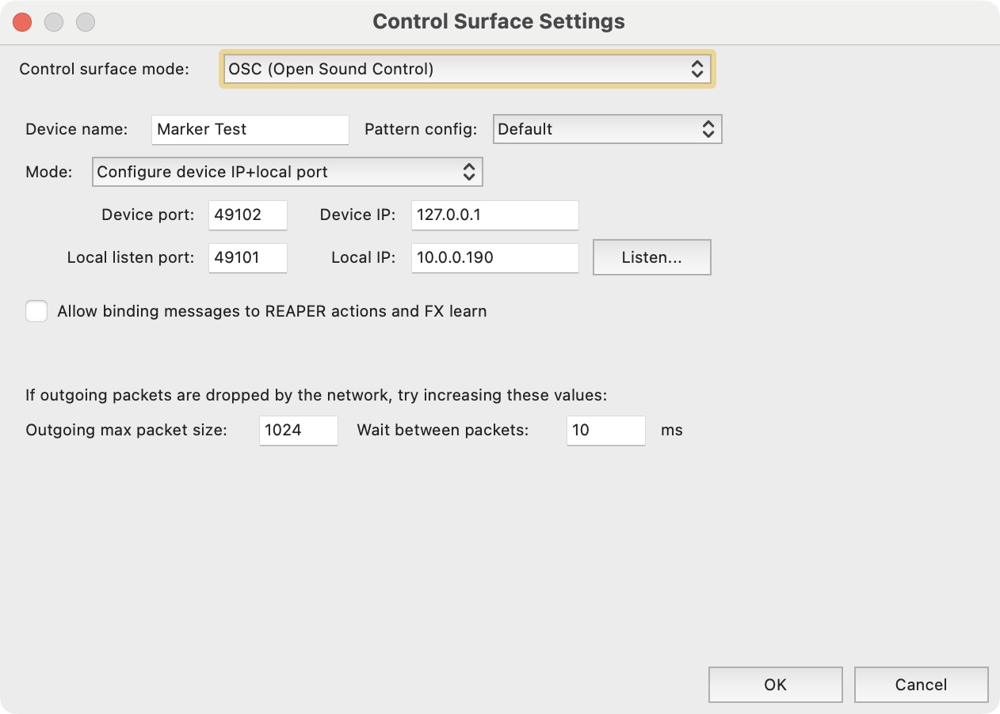
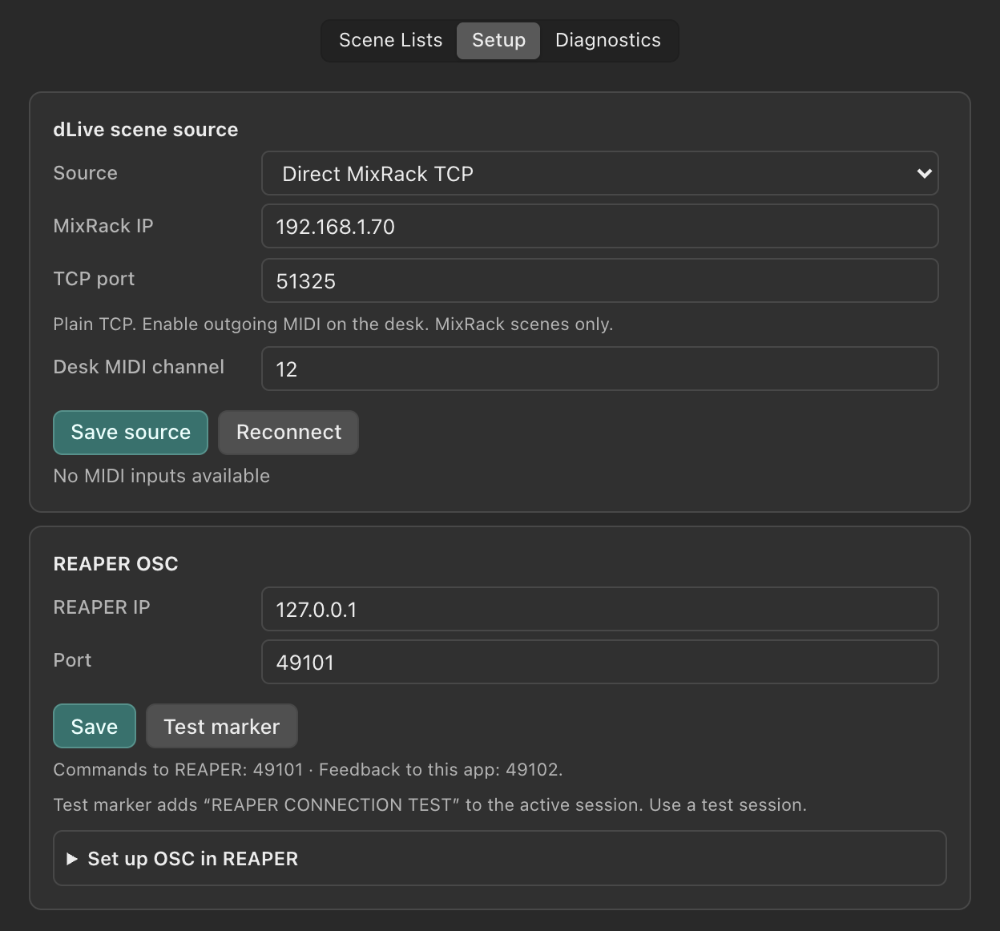

# dLive REAPER Link

**Current version: v0.3.0-beta.1 — macOS hardware-test build.**

Creates REAPER markers from dLive MixRack scene recalls, with optional REAPER playback-to-MixRack scene recall for virtual soundcheck. Choose direct MixRack MIDI-over-TCP or an existing MIDI input exposed by Allen & Heath MIDI Control. Playback recall requires Direct MixRack TCP.

## User guide

Download the [illustrated PDF user guide](docs/dLive-REAPER-Link-User-Guide.pdf). The screenshots are captured from the real macOS app and REAPER v7.80.



## Current features

- MixRack scenes 1–500, with configurable desk MIDI channel (1–12).
- Direct plain TCP connection with stream framing, MIDI running status, reconnect, and TCP keepalive.
- MIDI input fallback; only one selected source creates markers.
- Recording Only and Always marker modes.
- Off-by-default playback recall, using exact REAPER marker names and the selected scene list’s original scene-slot numbers. Preview and send status appear in Diagnostics.
- App-managed scene lists: edit, create, load, Save As, rename, delete, and `.drlscene` import/export.
- Rust-owned startup and recovery, independent of the Preferences window. Saved sources start automatically; missing sources wait and retry about every two seconds after a failed attempt.
- Stop Listening cancels recovery until Start Listening in that session. Reconnect does not override Stop. Refresh displays status without restarting healthy listening.
- Click the menu bar icon for a fixed-size Live dropdown. Click outside it or press Escape to dismiss it. Scene Lists, Setup, and Diagnostics open in a separate larger settings window with saved size and position.
- The settings window appears in the Dock and Command-Tab; its red close button hides it while the bridge stays active. Right-click the menu bar icon for status, Start/Stop Listening, Reconnect, Preferences…, and Quit. The app launches in the menu bar; Quit exits.

## Setup

1. In Setup, choose **Direct MixRack TCP** and enter the MixRack IP, plain TCP port (normally `51325`), and the desk's base MIDI channel. This implementation targets dLive firmware V2.0 and later. Enable outgoing MIDI on the desk. TLS ports and Surface cue recall are not supported in this beta.
2. Alternatively, connect Allen & Heath MIDI Control to the MixRack and select its MIDI input. Existing saved MIDI selections migrate automatically. Choose **Save source** to apply source settings.
3. Configure the REAPER OSC host and port, and enable OSC in REAPER. For Recording Only mode, configure REAPER OSC feedback to `127.0.0.1:49102` on the computer running this app.
4. Create, import, or load the appropriate scene list, choose the marker mode, and start listening from Live or the menu bar.

Green means the selected TCP socket or MIDI input is open. Amber means waiting/connecting, gray means stopped, and red means an error. A virtual MIDI port can remain present without a live desk. An open TCP connection does not confirm that outgoing scene MIDI is enabled or that REAPER received a marker. Check Diagnostics and use the separate REAPER test.

TCP keepalive helps detect silent network loss without treating an idle desk as disconnected. Detection time depends on the operating system; physical cable-loss timing still needs hardware testing. Pending scene recalls from a lost or replaced connection are discarded. With Playback recall Off, the desk connection remains receive-only. Turning Playback recall On enables scene commands to the MixRack.

## REAPER OSC configuration

The app has an expandable **Setup → REAPER OSC → Set up OSC in REAPER** guide.



The device name “Marker Test” in this screenshot is an example; any device name is acceptable. Local IP is REAPER’s displayed address.

OSC works in both directions: the app sends marker commands to REAPER’s listen port, while REAPER sends transport/marker feedback to this app on port 49102.

For both apps on the same Mac, open **REAPER Preferences → Control/OSC/web**, then Add an OSC entry or Edit the entry dedicated to this app:

| REAPER field | Value |
| --- | --- |
| Control surface mode | OSC (Open Sound Control) |
| Device name | dLive REAPER Link (any name) |
| Pattern config | Default |
| Mode | Configure device IP+local port |
| Device IP | 127.0.0.1 (the app’s feedback destination) |
| Device port | 49102 (feedback into the app) |
| Local listen port | 49101, or the port saved in this app (commands into REAPER) |

Confirm with OK. In this app, set **REAPER IP** to 127.0.0.1 and **Port** to the same Local listen port, then Save. Leave other OSC settings unchanged. Default.ReaperOSC already supplies the required action, transport, time, and last-marker mappings; no custom pattern file is required.

If REAPER runs on another computer, this app’s REAPER IP must be that computer’s IP. REAPER’s Device IP must be the IP of the computer running this app. Device port remains 49102; Local listen port still matches the app’s Port.

Run **Control surface: Refresh all surfaces** in REAPER’s Actions list and allow a couple of seconds for Diagnostics to show transport and current-marker feedback. Playback recall needs a marker at or before the cursor and a matching scene name. The app must also have a listening Direct MixRack TCP connection before recall can be enabled.



The app screenshot uses Director on localhost. For a physical desk, replace the MixRack IP with its actual IP; the same-computer REAPER address remains 127.0.0.1.

**Test marker** creates a marker named `REAPER CONNECTION TEST` in the active REAPER session. Use a disposable test session for that check.

## Playback recall

1. Use a separate REAPER test session and the corresponding scene list while validating this feature. A marker named `Song A` must match a scene named `Song A` exactly. Blank scene slots keep their numbers; REAPER marker numbers are never used as desk scene numbers. Duplicate non-empty scene names prevent enabling recall; unmatched or empty marker names cause no recall.
2. Connect using **Direct MixRack TCP**, with the correct desk base MIDI channel. The Live listener must show **Listening**. MIDI input fallback cannot send scene commands. The desk must accept incoming scene MIDI for playback recall.
3. Configure REAPER OSC feedback to the app computer on UDP port `49102`, using Default.ReaperOSC. The app consumes `/record`, `/play`, `/pause`, `/stop`, `/time`, and last-marker name/number/time feedback. Feedback is accepted from the configured REAPER OSC host IP. If REAPER runs on another computer, use that computer’s IP as the REAPER OSC host and the app computer’s IP as REAPER’s feedback destination.
4. In REAPER’s Actions list, run **Control surface: Refresh all surfaces**. Wait for transport and marker feedback to appear in Diagnostics; refresh is manual and its feedback is not instantaneous.
5. Turn **Live → Playback recall** On. Enabling during playback can immediately recall the current mapped scene. The toggle starts Off at every app launch.

While enabled:

- Normal playback recalls the currently reported marker’s matching scene when it differs from the last scene successfully sent in that enabled session.
- Stop/Play and Pause/Resume keep that remembered scene. They do not recall the same scene again.
- Same-song loops do not repeat recalls. Seeking or looping into a different mapped song recalls the destination, without sending commands for skipped scenes.
- Recording sends no scene recalls, even though REAPER also reports Play while recording. Recording does not update the remembered scene; later normal playback recalls the current mapped scene only if it differs.
- Incoming desk recalls cannot create REAPER markers, including in Always mode. Queued input from before disabling and a brief delayed echo of the last sent scene are also suppressed.
- Stop Listening, a lost/replaced desk connection, source changes, REAPER target changes, or scene-list edits/reloads turn recall Off. Loss of playback feedback for two seconds while REAPER is reported playing also turns it Off. Re-enable explicitly after recovery; commands are not queued or replayed. Re-enabling starts a new recall session.
- Hiding the app window leaves playback recall running in Rust.

Diagnostics distinguishes the mapped scene from **command sent**. A successful socket write does not confirm that the desk recalled it. These commands target MixRack scene slots; they do not navigate or reposition the Surface cue list.

## Version and validation

Find the app version in Diagnostics and include it in issue reports. See [CHANGELOG.md](CHANGELOG.md) for version history and [TOUR_TEST_NOTES.md](TOUR_TEST_NOTES.md) for the existing test-note format.

Nineteen Rust tests cover TCP framing, scene boundaries and channels, missing-at-start recovery, disconnect/reconnect, Stop/rearm, endpoint changes, settings migration, discarding stale queued recalls, all 500 outgoing scenes on base MIDI channels 1–12, exact simulated-desk bytes, failed writes, playback deduplication, recording exclusion, feedback settling, echo suppression, and REAPER feedback host filtering. Mocked browser checks cover source selection, listening controls, enumeration failure, event subscriptions, and default/minimum light/dark layouts.

Native localhost scene reception, Start/Stop/Refresh, version display, window close survival, keyboard Quit, and the macOS app build passed. User testing confirmed scene reception with dLive Director and reported the initial window/Command-Tab behavior working. The automated UI tool could not inspect the native tray dropdown. The native playback toggle was also checked with a loopback simulated MixRack: scene-send bytes, echo suppression, and automatic disarming on disconnect passed. User testing confirmed playback-triggered scene recall in dLive Director on 2026-10-14; the Surface cue list did not move, which the user accepted. Director validation is software validation. Physical MixRack reception/sending, MIDI unplug/replug, silent cable-loss detection, and end-to-end hardware recovery remain unverified.

## Later work

Optional independent Surface control for OSC-triggered Go/Next/Previous is deferred. Surface cue recall IDs must never be used as MixRack scene marker numbers. TLS and virtual MIDI output routing are also deferred.

## Development

```sh
npm install
npm run tauri dev
```
