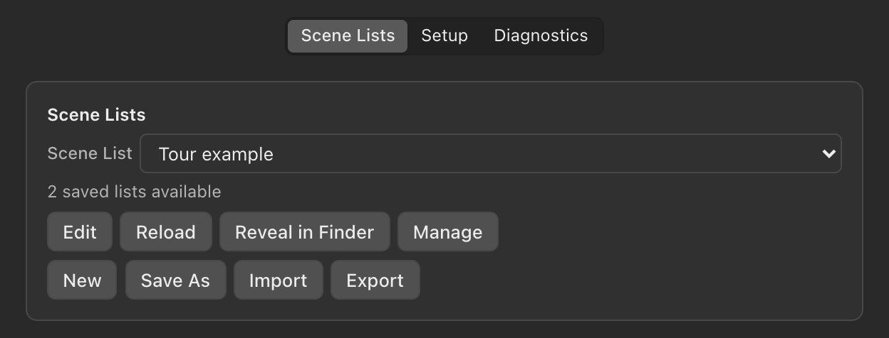
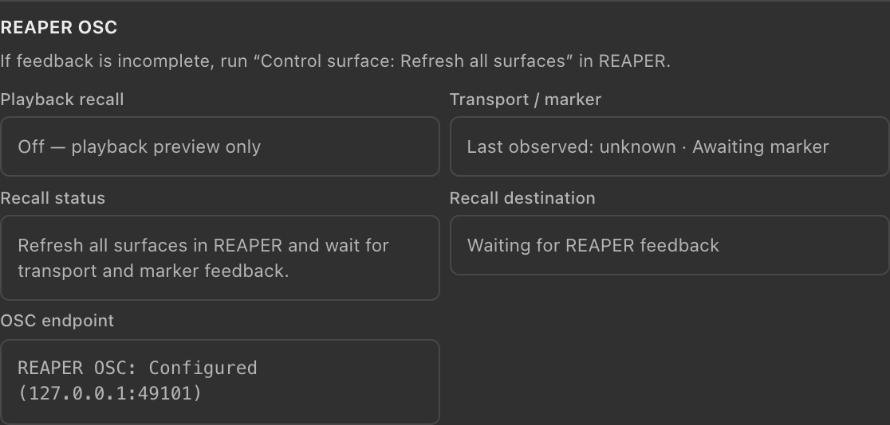

# dLive REAPER Link
## User guide - v0.3.0-beta.1

A menu bar bridge between dLive MixRack scene recalls and REAPER markers, with optional playback-driven scene recall for virtual soundcheck.

*Release UI with example data and a feedback warning. App figures use the actual release frontend rendered with simulated values. The REAPER figure is a real REAPER v7.80 capture.*

### Install and find the app

1. Open the universal DMG and drag **dLive REAPER Link** to **Applications**. Eject the disk image, then launch the copy in Applications. The download contains Apple Silicon and Intel code; Intel execution and installation on another Mac have not been verified.
2. The app starts in the **menu bar**. Click its icon for Live controls. Click outside the dropdown or press **Escape** to dismiss it.
3. Right-click the icon and choose **Preferences...** for **Scene Lists**, **Setup**, and **Diagnostics**. Settings can be resized and remembers its size and position.
4. Closing settings keeps the bridge running. Use **Quit** in the menu bar menu to exit. Playback recall starts **Off** at every launch.

### Before the first show

Use a separate REAPER test project and verify the full path with your own desk. Director and loopback testing have passed; physical MixRack/Surface, MIDI unplug/replug, silent network-loss timing, and hardware recovery remain unverified in this beta.

<!-- page -->

# 1. Connect the scene source

*Example network values. Replace the MixRack address with the address of your own desk.*

### Direct MixRack TCP

In **Preferences... > Setup**, choose **Direct MixRack TCP**. Enter the MixRack IP, its plain TCP port (normally **51325**), and the desk base MIDI channel (**1-12**). Enable outgoing MIDI on the desk, then click **Save source**. The protocol implementation targets dLive firmware V2.0 and later; TLS connections are not supported.

### MIDI input alternative

Connect Allen & Heath MIDI Control to the MixRack, choose **MIDI input**, click **Refresh**, select its input, set the desk MIDI channel, and click **Save source**. This input receives scene recalls for marker creation. Playback recall requires Direct MixRack TCP.

**Listening** means the selected socket or MIDI port is open. It does not confirm desk MIDI configuration or marker delivery. **Waiting** means automatic recovery is armed. **Stop Listening** cancels recovery until Start Listening; **Refresh** reads status, while **Reconnect** requests a new connection and does not override a deliberate Stop.

<!-- page -->

# 2. Configure REAPER OSC

*REAPER v7.80. The device name is arbitrary; Local IP is displayed by REAPER and may differ on your Mac.*

Open **REAPER Preferences > Control/OSC/web**. Add or edit the OSC entry dedicated to this app. For both apps on the same Mac:

| REAPER field | Setting |
| --- | --- |
| Control surface mode | OSC (Open Sound Control) |
| Device name | dLive REAPER Link (any name) |
| Pattern config | Default |
| Mode | Configure device IP+local port |
| Device IP | 127.0.0.1 - this app |
| Device port | 49102 - feedback into this app |
| Local listen port | 49101 - commands into REAPER |

Confirm with OK. In this app's Setup, save **REAPER IP 127.0.0.1** and **Port 49101**, or match your chosen REAPER Local listen port. No custom pattern file is needed.

Run **Control surface: Refresh all surfaces** from REAPER's Actions list. Wait a couple of seconds for Diagnostics to show transport and marker feedback. The expandable Setup guide repeats these settings.

For separate computers, this app targets the **REAPER computer's IP**; REAPER's Device IP targets the **app computer's IP**. Device port stays 49102 and Local listen port matches the app's Port. Feedback must originate from the configured REAPER host.

<!-- page -->

# 3. Scene lists and marker creation

*Example saved lists. List actions and file actions are grouped below the selector.*

### Prepare the correct list

Choose a saved list from the selector, or use **New** to create one. **Edit** opens the scene-name editor; **Save** applies changes. **Save As** creates another named list. **Import** and **Export** exchange .drlscene files. **Manage** offers rename and deletion; the currently loaded list cannot be deleted. **Reload** rereads the loaded list, and **Reveal in Finder** shows its file.

**Line number equals desk scene number.** There are 500 slots. Preserve empty lines so later scenes keep their original numbers. Do not remove blank slots to make the list look shorter. Match the list to your show before starting.

### Choose a marker mode in Live

**Recording Only** creates markers from incoming desk scene recalls while REAPER reports that it is recording. **Always** also allows creation while REAPER is not recording. The app starts in Recording Only mode.

Start listening, then operate REAPER and the desk manually. Incoming MixRack scene recalls use the selected list for marker names. Only one selected scene source is active. Playback recall must be Off for desk recalls to create markers.

### Check the REAPER connection separately

**Setup > Test marker** adds a marker named **REAPER CONNECTION TEST** to the active REAPER project. Use a disposable test project. A successful marker command does not establish physical desk connectivity. Check the resulting marker in REAPER before relying on the connection.

<!-- page -->

# 4. Optional playback recall

Playback recall sends a MixRack scene command when normal REAPER playback reaches a marker with a matching scene name. It is intended for virtual soundcheck and starts **Off** at every launch.

### The mapping

**REAPER marker name > exact matching scene-list name > original scene slot**

For example, if marker **Song A** matches the name in scene-list slot **17**, the destination is **MixRack scene 17**. REAPER's marker ID is never the desk scene number. Blank slots keep their numbers. Duplicate non-empty names block enabling recall; empty or unmatched markers cause no recall.

### Enable it deliberately

1. Use a separate REAPER test project and the matching scene list.
2. Connect using **Direct MixRack TCP**, confirm **Listening**, and configure the correct desk MIDI channel. The desk must accept incoming scene MIDI.
3. Configure REAPER OSC, run **Control surface: Refresh all surfaces**, and wait for fresh transport and current-marker feedback in Diagnostics. A marker at or before the cursor is required.
4. Turn **Playback recall On** in Live. Enabling during playback can immediately recall the current mapped scene.

### While it is On

- The same scene is not repeatedly sent across Stop/Play, Pause/Resume, or same-song loops. Seeking or looping into a different mapped song recalls the destination.
- Recording never sends scene recalls. Incoming desk recalls do not create REAPER markers while playback recall is On, including in Always mode.
- Stop Listening, a lost/replaced connection, source or REAPER target changes, and list edits/reloads turn recall Off. Stale feedback while playing also disarms it. Re-enable explicitly after recovery.
- Commands are not queued or retried. Re-enabling starts a new recall session. Closing settings leaves the Rust bridge running.

**Command sent is not confirmation of a physical recall.** Check the desk. This feature targets MixRack scene slots; it does not move or navigate the Surface cue list. MIDI output routing, Surface Go/Next/Previous, and TLS are not included.

<!-- page -->

# 5. Diagnostics and troubleshooting

*Release UI with example connection and feedback values; these are illustrative, not a hardware test result.*

**Waiting or connection refused:** check source choice, MixRack IP, plain TCP port, desk MIDI settings, and the network route. A present virtual MIDI port is not proof of a connected desk. Stop Listening deliberately pauses recovery; Start Listening rearms it.

**No markers in Recording Only:** confirm that REAPER is actually recording and that feedback is reaching port 49102 on the app computer. Run Refresh all surfaces manually and allow a couple of seconds. Check exact list names and the selected source.

**Cannot enable playback recall:** confirm Direct MixRack TCP is Listening, transport feedback is fresh, and the current REAPER marker exactly matches one non-duplicate scene name. Refresh feedback and enable explicitly after recovery.

**No physical recall after command sent:** verify incoming MIDI on the desk and its base MIDI channel. A successful socket write only confirms the app handed bytes to the connection. It does not confirm what the desk did.

### Report a useful issue

Include **v0.3.0-beta.1**, Mac model/macOS version, Director versus physical desk, source/port/channel, marker mode, playback recall state, exact marker name and expected scene slot, transport state, and steps to reproduce. Use the repository's Issues page and the Tour Test Notes format.

This beta has passed automated Rust and browser checks and software testing with Director. Physical desk recovery, Intel execution, and installation on another Mac remain unverified. The bundle declares macOS 10.13 as its minimum; older macOS versions have not been tested.
